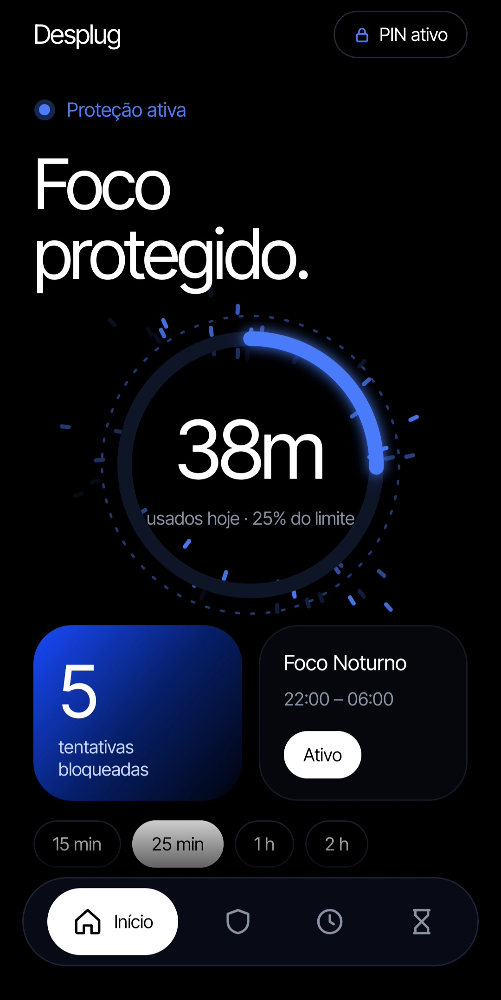
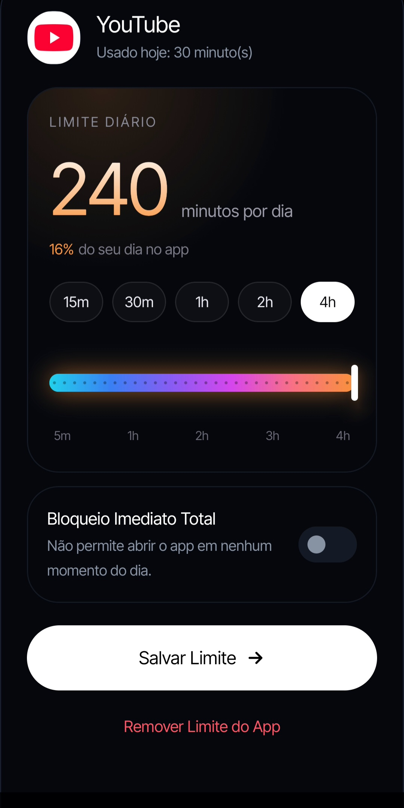
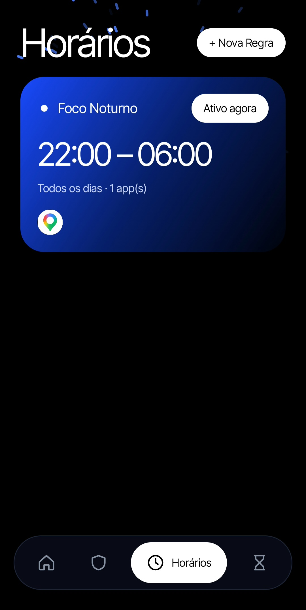
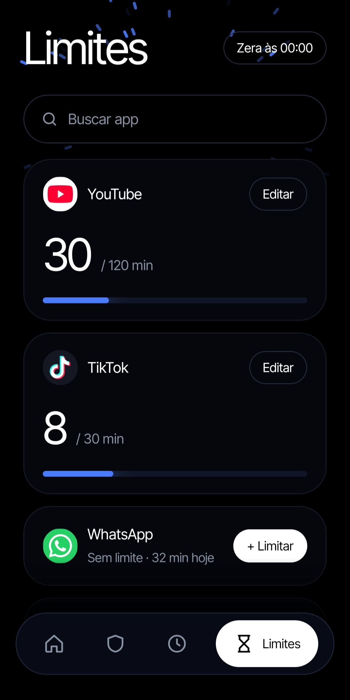

# Desplug

Aplicativo Android local-first (sem backend, sem login, sem conexao externa) para gerenciamento de tempo de tela e bloqueio de aplicativos.

## Screenshots

<p align="center">
  
  
  
  
</p>

| Início | Quick Block | Horários | Bloqueio |
| :---: | :---: | :---: | :---: |
| Tempo de uso e métricas diárias | Bloqueio temporário imediato | Regras programadas por horário | Interceptação em tempo real |

## Funcionalidades

- Limite diário de uso por aplicativo (via UsageStatsManager).
- Regras de bloqueio por horário e dias da semana (com suporte a cruzamento de meia-noite).
- Quick Block temporário com proteção por PIN e espera obrigatória de 5 minutos para cancelamento.
- Tela de bloqueio instantânea sobreposta com contador de tentativas.
- Serviço em primeiro plano persistente e reinicialização automática no boot.
- Proteção contra desinstalação e fechamento forçado via AccessibilityService e DeviceAdmin.

## Stack

- Kotlin Nativo
- Jetpack Compose (Material 3)
- Android SDK (minSdk 26, targetSdk 34)
- Room Database / DataStore Preferences

## Permissões Requeridas

| Permissão | Finalidade |
| :--- | :--- |
| PACKAGE_USAGE_STATS | Medição de tempo de tela em primeiro plano. |
| SYSTEM_ALERT_WINDOW | Sobreposição da tela de bloqueio. |
| ACCESSIBILITY_SERVICE | Detecção imediata de abertura de apps e proteção anti-burla. |
| DEVICE_ADMIN | Proteção contra desinstalação não autorizada. |
| FOREGROUND_SERVICE | Persistência do serviço de monitoramento. |
| RECEIVE_BOOT_COMPLETED | Inicialização automática com o sistema. |
| REQUEST_IGNORE_BATTERY_OPTIMIZATIONS | Imunidade ao encerramento pelo gerenciador de bateria. |

## Liberar Configurações Restritas (Android 13+)

Ao instalar o APK via sideload, o Android bloqueia o Serviço de Acessibilidade por padrão. Para liberar:

1. Acesse `Configurações > Aplicativos > Desplug`.
2. Toque no menu de três pontos no canto superior direito (`⋮`).
3. Selecione `Permitir configurações restritas` e confirme a autenticação (PIN ou biometria).
4. Retorne em `Configurações > Acessibilidade > Desplug` e ative o serviço.

## Build

Compilação via Gradle:

```bash
cd desplug-app
./gradlew assembleDebug
```

O APK gerado fica em `desplug-app/app/build/outputs/apk/debug/app-debug.apk`.
